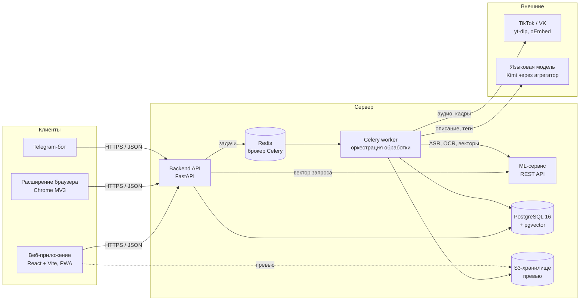
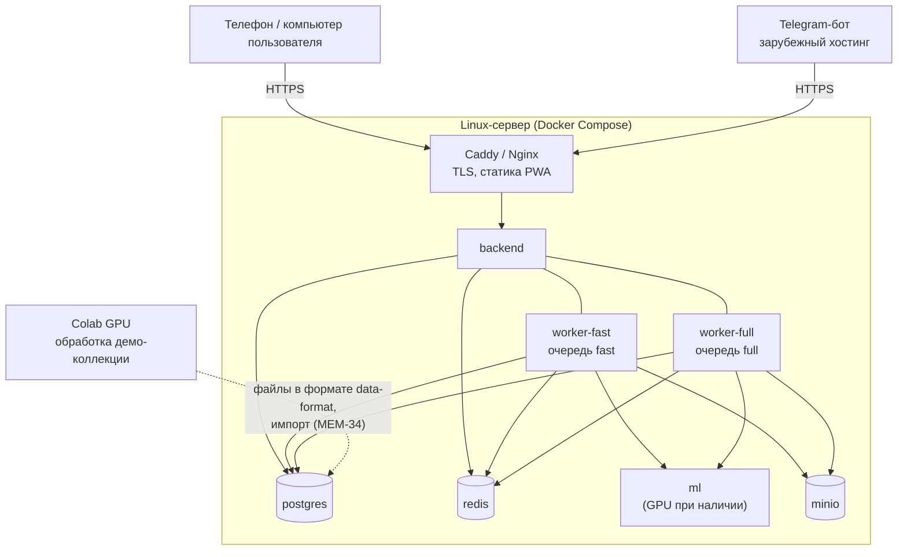
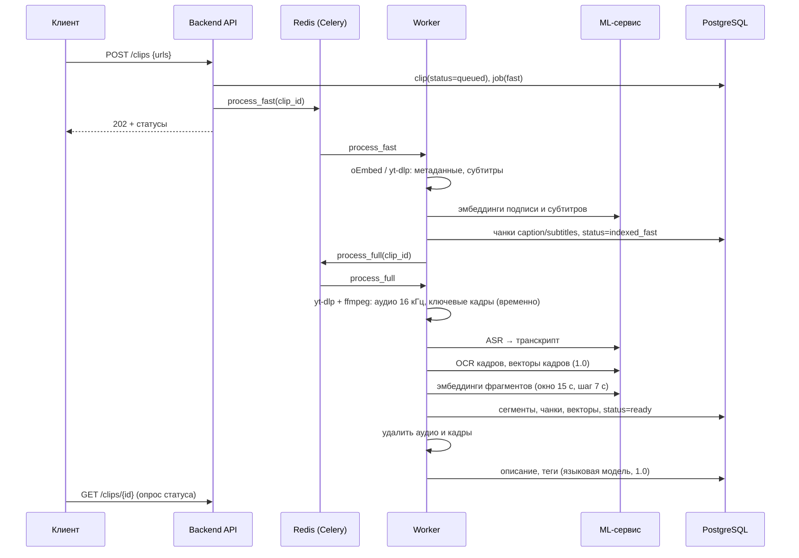
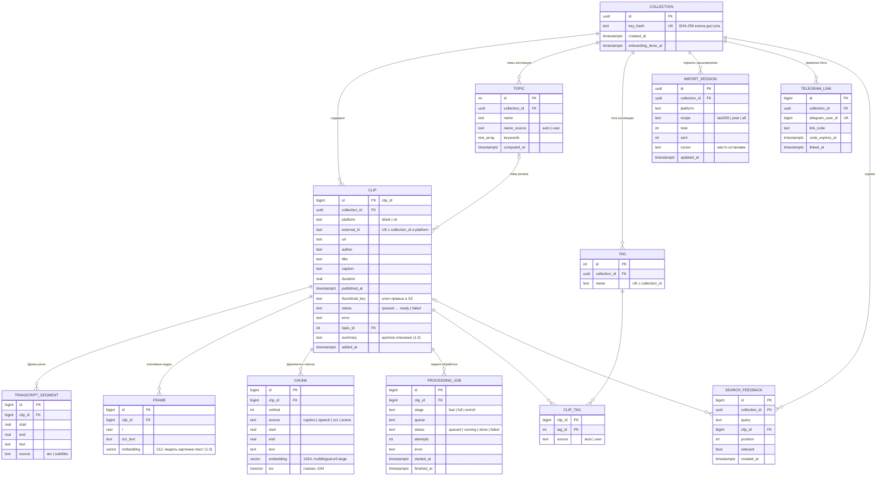

# Описание архитектуры и модели данных

**Задача:** MEM-26 · **Дата:** 29.10.2026 · **Основание:** [ADR-001](adr/001-technology-stack.md), спецификация требований (SRS v0.1), [решения по продукту](decisions.md), [формат данных ML-конвейера](data-format/README.md)

## 1. Обзор

MemSearch — веб-приложение (PWA, mobile-first) для поиска сохранённых роликов TikTok и VK по смыслу сказанного, тексту в кадре и описанию сцены. Пользователь добавляет ссылки, система в фоне скачивает аудио и кадры, распознаёт речь и текст, строит векторы фрагментов и ищет по ним гибридным поиском (векторный + полнотекстовый). Выдача показывает ролики целиком (решение 11): поиск ведётся по фрагментам, но один ролик — одна карточка.

Ключевые свойства, определяющие архитектуру:

| Требование | Как обеспечивается |
|---|---|
| Поиск ≤ 2 с на 10 000 роликов (НФТ-1) | pgvector с индексом HNSW и полнотекстовый индекс GIN в одной СУБД; вектор запроса считает ML-сервис синхронно |
| Обработка ролика ≤ 1 мин на GPU (НФТ-2) | Длительная обработка — в Celery worker, вне HTTP-запроса; ML-модели в отдельном сервисе |
| Перенос 1000 роликов, поиск по названию через 10 мин (НФТ-6, ФТ-2.5) | Два прохода: быстрый (метаданные, готовые субтитры) и полный; две очереди с приоритетом новых роликов (ФТ-2.6) |
| Видео и аудио не хранятся (НФТ-8, ФТ-2.1) | Аудио и кадры — во временном каталоге worker и удаляются после обработки; в S3 — только превью |
| Без учётных записей (ФТ-7.5 в бэклоге, вопрос В-1) | Коллекция идентифицируется секретным ключом, который хранится на устройстве; Telegram-бот привязывается одноразовым кодом |
| Модели заменяются настройкой (ФТ-8.3) | Модели ASR, эмбеддингов и языковая модель задаются переменными окружения ML-сервиса |

## 2. Компоненты

| Компонент | Ответственность | Технологии |
|---|---|---|
| Веб-приложение | Поиск, выдача, карточка ролика, добавление ссылок, темы, профиль; приём ссылок из «Поделиться» на Android (Web Share Target) | React, TypeScript, Vite, PWA |
| Расширение браузера | Сбор ссылок со страницы «Избранное» TikTok (затем VK) и пакетная отправка в коллекцию с возобновлением (ФТ-1.6) | Chrome Manifest V3 |
| Telegram-бот | Приём ссылок с iPhone и пересылка в API от имени привязанной коллекции (ФТ-1.5, ФТ-7.2) | aiogram; размещается вне России (вопрос В-4) |
| Backend API | REST API ([OpenAPI](api/openapi.yaml)), проверка ссылок и дубликатов, постановка задач, поиск, теги, темы, оценки | FastAPI, SQLAlchemy 2 (async, asyncpg), Alembic, Pydantic |
| Celery worker | Конвейер обработки ролика: скачивание → распознавание → фрагменты → векторы → обогащение; статусы и повторы | Celery, yt-dlp, ffmpeg |
| ML-сервис | Модели: распознавание речи, эмбеддинги текста, OCR, векторы кадров, тематическое моделирование | FastAPI, faster-whisper large-v3, multilingual-e5-large, BERTopic, OCR, CLIP/SigLIP |
| PostgreSQL + pgvector | Все предметные данные, векторы фрагментов (HNSW), полнотекстовый индекс (GIN, `russian`), триграммы (`pg_trgm`) для нечёткого поиска | PostgreSQL 16, pgvector 0.8 |
| Redis | Брокер и хранилище результатов Celery | Redis 7 |
| S3-хранилище | Уменьшенные превью и ключевые кадры для карточек | MinIO (локально), любое S3-совместимое |

## 3. Развёртывание

- Все сервисы описаны в одном `compose.yaml` и поднимаются одной командой (НФТ-12). Backend и оба worker используют один образ `backend` с разными командами запуска.
- Сервер, скорее всего, без GPU. Распознавание large-v3 на CPU в разы медленнее, поэтому демо-коллекция обрабатывается в Colab на GPU и импортируется файлами ([data-format](data-format/README.md)); новые ролики обрабатываются на сервере (на CPU — модель small как запасной вариант, решение 13).
- Скачивание TikTok с российского IP может быть заблокировано (вопрос В-3) — worker поддерживает HTTP-прокси для yt-dlp через переменную окружения.
- Резервная копия базы — ежедневный `pg_dump` в отдельный том (ФТ-8.4).

## 4. Обработка ролика

- **Статусы ролика:** `queued → downloading → transcribing → indexing → enriching → ready`; при сбое — `failed` с причиной (`error`). Повтор — `POST /clips/{id}/retry` (ФТ-2.7).
- **Очереди:** `fast` — первый проход и новые ролики, добавленные по одному (ФТ-2.6); `full` — полная обработка при массовом переносе. Ошибка одного ролика не останавливает очередь.
- **Темы** пересчитываются отдельной периодической задачей при изменении коллекции на 10 % и более (BERTopic по векторам роликов); пользовательские названия тем сохраняются (ФТ-5.4).

## 5. Поиск

1. Backend получает запрос, ML-сервис возвращает вектор `query: <запрос>` (multilingual-e5-large, 1024, решение 14).
2. Два запроса в PostgreSQL по фрагментам коллекции: векторный (`embedding <=> :q`, индекс HNSW, топ-200) и полнотекстовый (`tsv @@ websearch_to_tsquery('russian', :q)` + триграммы `pg_trgm` для опечаток и ошибок ASR, ФТ-3.3).
3. Результаты объединяются методом Reciprocal Rank Fusion; оценка ролика — лучший из его фрагментов (ФТ-3.4).
4. Для каждого ролика возвращается лучший фрагмент как «почему найден»: источник (`speech`, `caption`, `ocr`, `scene`) и цитата до 100 символов (ФТ-3.5).
5. Фильтр по теме — условие `clips.topic_id` (ФТ-3.6). Оценки «подходит / не подходит» сохраняются с позицией в выдаче (ФТ-3.8).

Реранкер не используется: на CPU он тратит ~40 с на запрос при прибавке +0,01 MRR (решение 14).

## 6. Безопасность и приватность

- **Доступ к коллекции.** При создании коллекции клиент получает ключ (32 случайных байта, base64url), в базе хранится только его SHA-256. Ключ передаётся в заголовке `Authorization: Bearer <ключ>`. Перенос на другое устройство — по QR-коду или ссылке с ключом. Telegram-бот привязывается одноразовым кодом со сроком 10 минут (ФТ-7.2). При появлении учётных записей (ФТ-7.5) коллекция получит владельца без изменения остальных таблиц.
- Видео и аудио не хранятся; во внешнюю языковую модель передаются только транскрипт, текст в кадре и подпись ролика, без идентификаторов пользователя (НФТ-8).
- Журнал (ФТ-8.2) пишет методы, коды ответов и время, но не тексты поисковых запросов.
- Удаление всех данных (ФТ-7.3) — каскадное удаление коллекции.

## 7. Модель данных

### Соответствие требованиям SRS

| Сущность | Требования | Примечания |
|---|---|---|
| `collection` | ФТ-6.1, ФТ-7.3, НФТ-8, В-1 | Вместо пользователя: учётные записи в бэклоге (ФТ-7.5) |
| `clip` | ФТ-1.1–1.3, ФТ-1.7, ФТ-1.8, ФТ-2.8, ФТ-4.1–4.3, ФТ-7.1 | Уникальность `(collection_id, platform, external_id)` — защита от дубликатов (ФТ-1.2) |
| `transcript_segment` | ФТ-2.2, ФТ-2.3, ФТ-4.4, ФТ-4.6 | Фразы с таймкодами; источник — распознавание или готовые субтитры платформы |
| `frame` | ФТ-2.9, ФТ-2.10, ФТ-3.9 | Версия 1.0; сами кадры не хранятся, только текст и вектор |
| `chunk` | ФТ-2.4, ФТ-3.2–3.5 | Единица поиска; HNSW по `embedding` (`vector_cosine_ops`), GIN по `tsv`, GIN `gin_trgm_ops` по `text` |
| `tag`, `clip_tag` | ФТ-5.1, ФТ-5.2 | Ручные теги (`user`) не удаляются при пересчёте |
| `topic` | ФТ-3.6, ФТ-5.3–5.6 | Пользовательское название сохраняется при пересчёте |
| `processing_job` | ФТ-2.5–2.7, ФТ-8.1 | Состояние обработки не зависит от Celery (ADR-001) |
| `import_session` | ФТ-1.6 | Возобновление переноса с места остановки |
| `telegram_link` | ФТ-1.5, ФТ-7.2 | Одноразовый код привязки |
| `search_feedback` | ФТ-3.8 | Выгрузка для администратора и для оценки качества |

Размер индекса: на ролик в среднем ~9 фрагментов (решение 14), 10 000 роликов → ~90 000 векторов × 4 КБ ≈ 370 МБ плюс индекс HNSW; проверка скорости — MEM-78.

## 8. Открытые вопросы

| Вопрос | Где решается |
|---|---|
| Прокси для скачивания TikTok с российского сервера | MEM-20 (В-3) |
| Хостинг Telegram-бота за рубежом | созвон с заказчиком (В-4) |
| Отличать запросы без ответа («ничего не найдено»): порог или гибрид с BM25 | MEM-41 |
| Модель OCR и «картинка — текст» | MEM-58, MEM-87 |
