# Похожие сервисы: конкурентный анализ

> Задача [MEM-15](https://stackminds.atlassian.net/browse/MEM-15) · этап 2 «Исследование и анализ требований» · исполнитель — Тисецкая А.
> Черновик от 30.09.2026. API платформ и сервисов разобраны отдельно: [../api/README.md](../api/README.md).

## Кратко

- **Есть прямые мобильные конкуренты (2026):** ReelRecall, Sorti, Fabric, TapFold сохраняют TikTok и Reels через «Поделиться» и ищут по сказанному. Наше отличие — русский язык, VK, перенос всего «Избранного» расширением, поиск по кадру, бесплатно и из России. Подробно — раздел «Мобильные приложения».
- **Ближайший аналог — [Recall](#1-recall)**: пересказывает сохранённые ролики YouTube и TikTok, сам ставит теги, отвечает на вопросы по всей базе. Не работает с VK, бесплатно даёт только 10 пересказов в месяц, из России не оплатить.
- **Ни один сервис не сочетает три вещи:** клипы VK, поиск по сказанному в личной коллекции и бесплатность. Это наша ниша.
- **Главный риск — сама VK.** У неё уже есть распознавание речи в клипах и поиск по смыслу по всей платформе. Поиска по личному «Избранному» пока нет.
- **Все западные сервисы из России нельзя оплатить.** Часть из них нельзя использовать даже с VPN: условия Twelve Labs прямо запрещают пользователей из России.

Скриншоты главных страниц сняты 30.09.2026 и лежат в [`img/`](img).

---

## Сводная таблица

| Сервис | Тип | Что умеет по видео | Клипы VK | Цена | Из России |
|---|---|---|---|---|---|
| [Recall](#1-recall) | ИИ-база знаний | пересказ, автотеги, граф связей, вопросы по базе | нет | 10 пересказов/мес бесплатно, Plus 10 $/мес | сайт — проверить без VPN; оплата невозможна |
| [Raindrop.io](#2-raindropio) | менеджер закладок | в Pro — поиск по транскриптам YouTube, ИИ-ассистент | как ссылка | Pro ≈ 28 $/год | сайт — проверить без VPN; оплата невозможна |
| [mymind](#3-mymind) | «умное» хранилище | автотеги, текст на картинках; транскриптов видео нет | как ссылка | ≈ 129 $/год | сайт — проверить без VPN; оплата невозможна |
| [Dewey](#4-dewey) | архив закладок соцсетей | импорт «Избранного» TikTok и Instagram, поиск по метаданным | нет | не выяснено | нужен VPN для TikTok и Instagram |
| [Яндекс: пересказ видео](#5-яндекс-пересказ-видео-300yaru) | пересказ по ссылке | пересказ блоками с таймкодами | ролики от 2 мин | бесплатно, вход через Яндекс ID | без VPN |
| [Mediata](#6-mediata-и-сервисы-транскрибации) | транскрибация по ссылке | транскрипт, спикеры, пересказ, вопросы по ролику | да (VK Видео) | есть бесплатный старт | без VPN |
| [VK Видео и VK Клипы](#7-vk-видео-и-vk-клипы) | сама платформа | субтитры по речи, поиск по смыслу по всей платформе | да | бесплатно | без VPN |
| [Twelve Labs](#8-twelve-labs) | API для разработчиков | мультимодальный поиск и описание видео | загрузка файла | 600 мин бесплатно, дальше за минуту | **запрещено условиями** |
| [Memories.ai](#9-memoriesai) | API и приложение | поиск моментов на естественном языке, чат по видео | загрузка файла | есть бесплатный уровень | сайт — проверить без VPN |

«Проверить без VPN» — доступ напрямую из России не подтверждён: автоматическая проверка шла через нидерландский IP.

---

## 1. Recall

**Сайт:** <https://www.recall.it> · расширение: [Chrome Web Store](https://chromewebstore.google.com/detail/recall-summarizer-youtube/ldbooahljamnocpaahaidnmlgfklbben) · документация: <https://docs.recall.it>

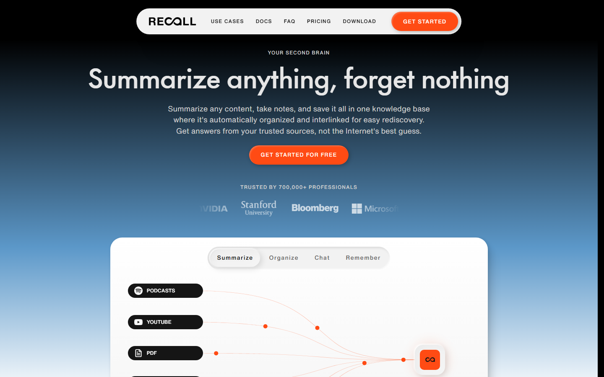

**Что это.** «Второй мозг»: сохраняешь ролик, статью, PDF или подкаст — Recall делает структурированный пересказ и складывает карточку в личную базу знаний.

**Функционал:**
- поддерживает ролики YouTube (включая Shorts), TikTok, статьи, PDF, подкасты Spotify и Apple Podcasts, Google Docs и Slides;
- автоматически ставит вложенные теги и строит граф знаний, связывая материалы, сохранённые в разное время;
- вопросы можно задавать по одной карточке, группе, всей базе или базе вместе с интернетом;
- карточки для повторения и тесты (интервальное повторение);
- есть API только на чтение (список карточек, их содержимое, семантический поиск) и MCP-сервер.

**Цена:** бесплатно 10 ИИ-пересказов в месяц; Recall Plus — 10 $ в месяц или 7 $ при оплате за год.

**Для нас:**
- ✅ перенять: карточка «пересказ + теги» сразу после сохранения; вопрос ко всей коллекции;
- ❌ не подходит: нет VK, англоязычный интерфейс, лимит бесплатного тарифа, уклон в обучение, а не в быстрый поиск ролика.

## 2. Raindrop.io

**Сайт:** <https://raindrop.io> · API: <https://developer.raindrop.io>

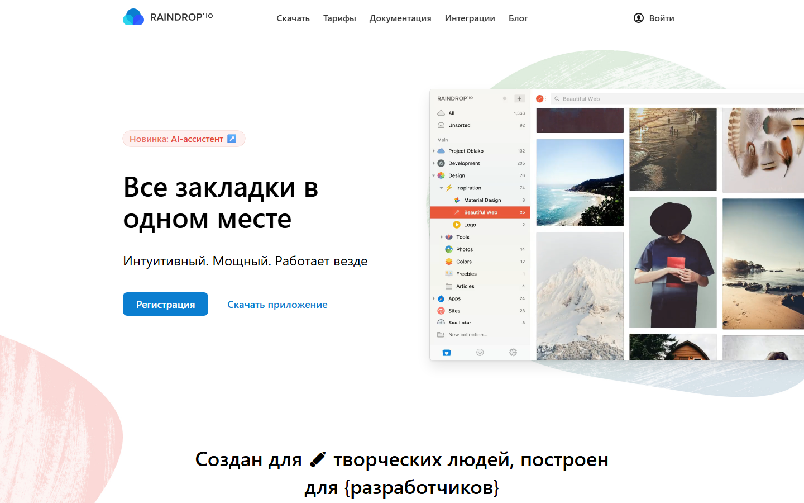

**Что это.** Кроссплатформенный менеджер закладок: веб, расширения браузера, мобильные приложения.

**Функционал:**
- коллекции, вложенные коллекции, теги, фильтры, поиск дубликатов, архивные копии страниц, выделения и заметки;
- в Pro — полнотекстовый поиск по содержимому закладок: страницы, PDF, EPUB и **транскрипты роликов YouTube**;
- в Pro — ИИ-ассистент Stella: предлагает теги и коллекцию при сохранении, пересказывает ролик YouTube и находит момент, где было сказано нужное;
- открытый REST API (OAuth2, 120 запросов в минуту на пользователя).

**Цена:** базовый тариф бесплатный; Pro — около 28 $ в год.

**Для нас:**
- ✅ перенять: подсказка тегов в момент сохранения; поиск «до произнесённого слова»;
- ❌ ограничение: речь анализируется только для YouTube и только в Pro; клип VK для Raindrop — обычная ссылка;
- ⚠️ поправка к документу-концепции: там написано, что Raindrop не анализирует речь в видео. Для YouTube в Pro уже анализирует.

## 3. mymind

**Сайт:** <https://mymind.com> · тарифы: <https://access.mymind.com/pricing>

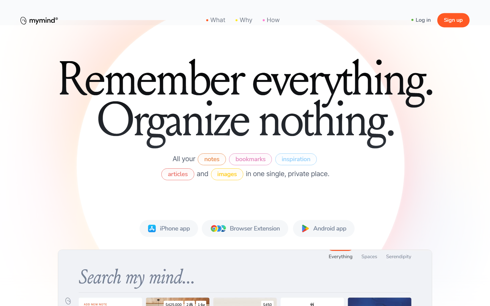

**Что это.** Личное «умное» хранилище с девизом «запоминай всё, ничего не упорядочивай».

**Функционал:**
- ИИ автоматически размечает всё сохранённое: изображения, ссылки, заметки, видео;
- распознаёт текст на картинках и скриншотах, по нему можно искать;
- «умные пространства» сами собирают похожие сохранения, без ручных папок;
- упор на приватность: данные не продаются и не используются для рекламы;
- пересказов и транскриптов видео нет, API нет.

**Цена:** около 129 $ в год за полный ИИ; постоянного бесплатного тарифа нет, есть пробный период.

**Для нас:**
- ✅ перенять: коллекция упорядочивается сама, без ручной работы;
- ❌ слабое место: непонятно, почему элемент попал в группу, и это нельзя поправить. У нас темы и теги должны быть редактируемыми.

## 4. Dewey

**Сайт:** <https://getdewey.co>

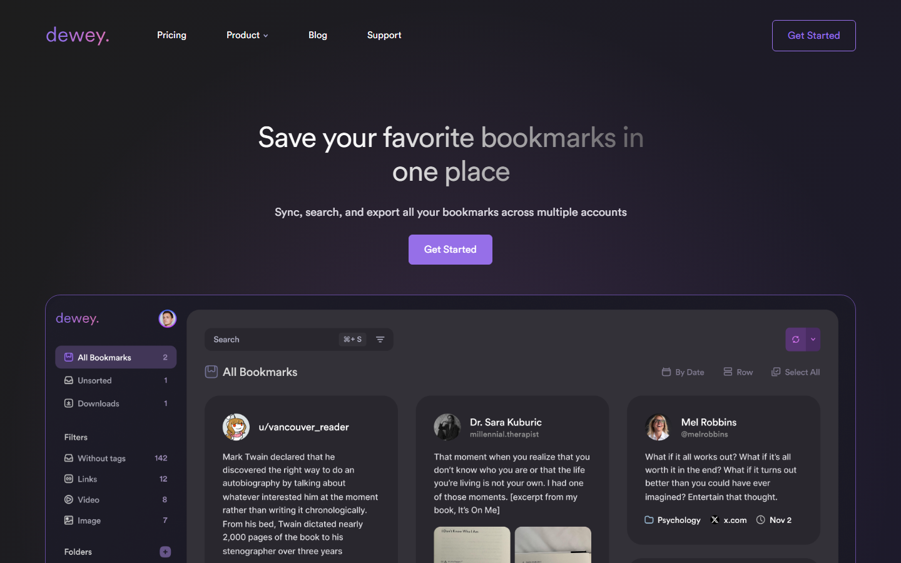

**Что это.** Архив закладок из соцсетей: TikTok, Instagram, Reddit, Bluesky, LinkedIn, Threads, Substack и другие.

**Функционал:**
- расширение Chrome подключается к аккаунту соцсети и **автоматически забирает всё «Избранное»**;
- поиск по названию, описанию и комментариям, папки, теги, экспорт;
- упомянут ИИ-ассистент, подробностей нет.

**Цена:** не выяснена — уточнить на странице тарифов.

**Для нас:**
- ✅ самое сильное UX-решение среди аналогов — импорт всего «Избранного» одним действием. Официального API для этого у платформ нет (см. [../api/README.md](../api/README.md)), поэтому Dewey читает страницы от имени пользователя через расширение. Кандидат на развитие после MVP;
- ❌ ищет только по метаданным, а не по речи; VK не поддерживает.

## 5. Яндекс: пересказ видео (300.ya.ru)

**Сайт:** <https://300.ya.ru> · новость: [yandex.ru/company/news](https://yandex.ru/company/news/01-06-10-2023) · как устроено: [Хабр](https://habr.com/ru/companies/yandex/articles/795397/)

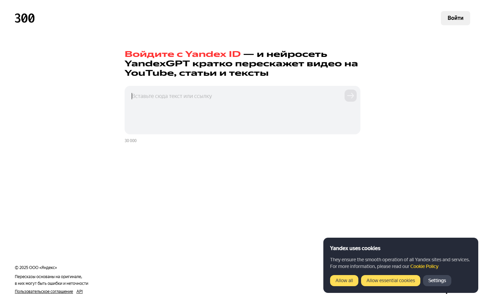

**Что это.** Пересказ видео нейросетью YandexGPT в Яндекс Браузере, Поиске и на 300.ya.ru.

**Функционал:**
- распознаёт речь, делит текст на смысловые блоки, пересказывает каждый блок и ставит таймкод начала;
- русскоязычный контент;
- ролики длительностью **от 2 минут до 4 часов**.

**Цена:** бесплатно, нужен вход через Яндекс ID.

**Для нас:**
- ✅ перенять: пересказ с таймкодами и переход к нужному моменту;
- ❌ короткие клипы до 2 минут не обрабатываются; нет личной коллекции и поиска по ней.

## 6. Mediata и сервисы транскрибации

**Сайт:** <https://mediata.ai/ru/video-notes> · похожие: [Транскрипта](https://transcripta.ru/vk-video-v-tekst), [Speech2Text](https://speech2text.ru/online-VK-video-v-tekst)

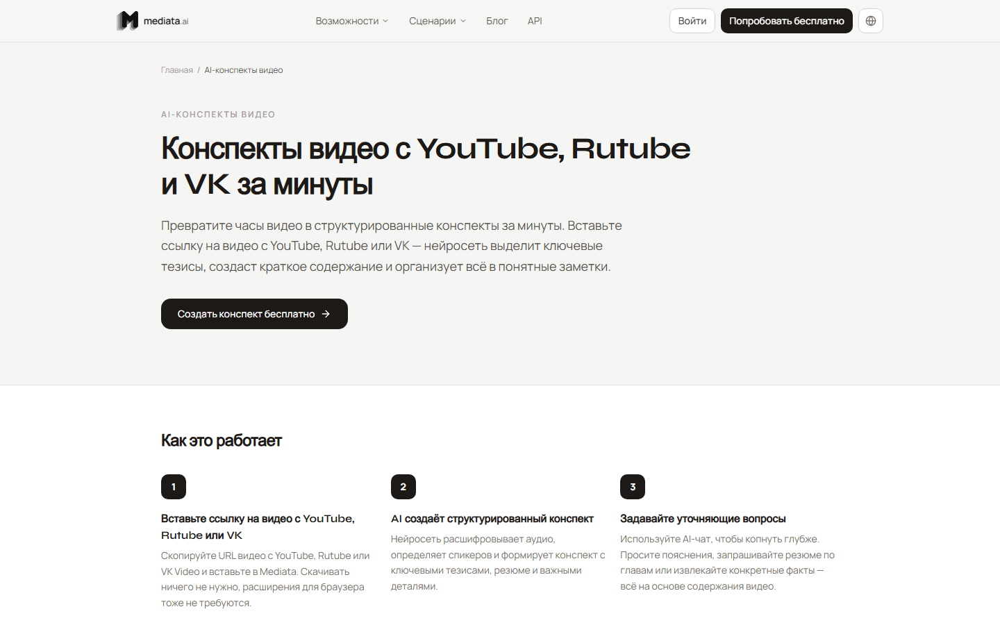

**Что это.** Отечественные сервисы «видео → текст» по ссылке.

**Функционал (Mediata):**
- принимает ссылки YouTube, Rutube, VK Видео, а также файлы и прямые эфиры;
- транскрипт с таймкодами и разметкой спикеров, пересказ с ключевыми тезисами, ответы на вопросы по ролику.

**Цена:** бесплатный старт; тарифы не выяснены.

**Для нас:**
- ✅ подтверждают спрос на обработку русскоязычного видео из VK;
- ❌ работают с одним роликом за раз; поиск по своей библиотеке роликов — не основной сценарий.

## 7. VK Видео и VK Клипы

**Сайты:** <https://vkvideo.ru> · <https://vk.com/clips>

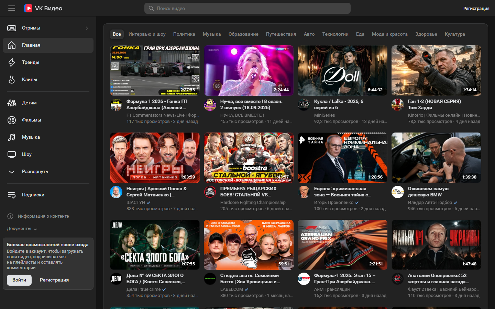

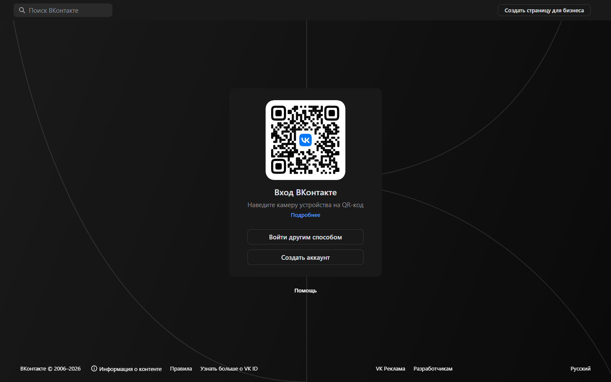
*Без входа в аккаунт клипы не открываются — только QR-код для входа.*

**Функционал, связанный с нашей задачей:**
- сохранение клипов и видео, лента рекомендаций, поиск по платформе;
- распознавание речи: субтитры в VK Видео и VK Клипах. В декабре 2025 г. модель обновили, она точнее прежней на 20 % ([iXBT](https://www.ixbt.com/news/2025/12/08/vk-vk-vk.html));
- поиск по смыслу: платформа Discovery AI ([vc.ru](https://vc.ru/ai/3027970-vk-discovery-ai-poisk-neurosset)); в феврале 2026 г. в поиск VK Видео внедрена мультимодальная модель, которая учитывает смысл ролика, а не только название и описание ([VK](https://vk.company/ru/press/releases/12230/)).

**Для нас:**
- ❌ «Избранное» — лента по дате, поиска внутри сохранённого по содержанию нет, пересказов и автоматических тем нет;
- ⚠️ главный риск: технологии для поиска по «Избранному» у VK уже есть. Наше отличие — пересказы, автотемы и работа с коллекцией как с базой знаний;
- ✅ возможность: если клипы VK уже имеют автосубтитры, их можно забирать через yt-dlp как готовый транскрипт. Проверить в [MEM-14](https://stackminds.atlassian.net/browse/MEM-14).

## 8. Twelve Labs

**Сайт:** <https://www.twelvelabs.io> · тарифы: <https://www.twelvelabs.io/pricing> · документация: <https://docs.twelvelabs.io>

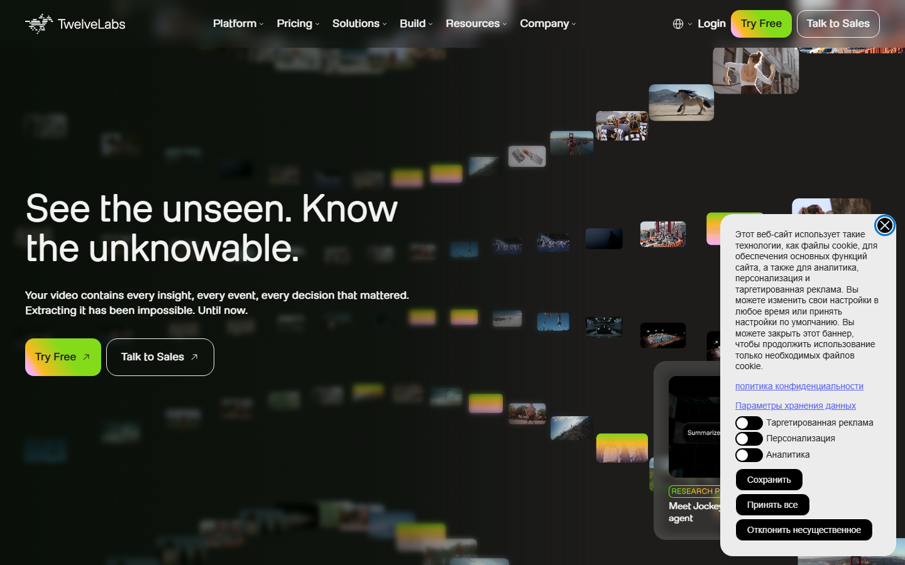

**Что это.** Облачная платформа «понимания» видео для разработчиков.

**Функционал:**
- модель Marengo — мультимодальный поиск и эмбеддинги по изображению, речи и тексту в кадре;
- модель Pegasus — генерация текста по видео: описания, ответы на вопросы;
- REST API и SDK.

**Цена:** бесплатно до 600 минут видео; дальше оплата за минуту индексации (Pegasus — 0,042 $ за минуту).

**Для нас:**
- ❌ **условия использования запрещают доступ пользователям, находящимся в России** ([Terms of Use](https://www.twelvelabs.io/legal/terms-of-use)). Не используем даже как запасной вариант;
- ✅ ориентир: как выглядит «поиск момента по описанию» у лидера рынка.

## 9. Memories.ai

**Сайт:** <https://memories.ai> · API: <https://memories.ai/docs/>

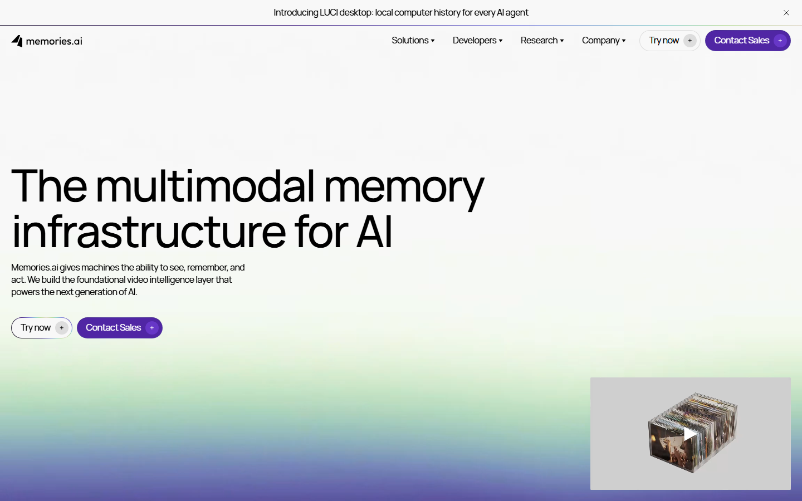

**Что это.** Платформа «визуальной памяти» для видео: большая модель, которая индексирует видео один раз и потом переиспользует индекс.

**Функционал:**
- поиск моментов в видеобиблиотеке по описанию на естественном языке;
- чат по видео с визуальными ссылками на фрагменты;
- REST API для индексации и семантического поиска.

**Цена:** есть бесплатный уровень.

**Для нас:** технология для разработчиков и маркетологов, а не для зрителя. Ограничения для России не выяснены — не используем.

---

## Мобильные приложения

> UX/UI-разбор экранов (🟢🟣🟠🔴) и что принимает каждое приложение — [ux-analysis.md](ux-analysis.md) и Figma, страница «8. Конкурентый анализ». (добавлено 10.10.2026)

Продукт делаем mobile-first, поэтому отдельно разобраны мобильные приложения. **Главная находка: прямые конкуренты существуют.** В 2026 году появилось несколько приложений, которые сохраняют TikTok и Reels через меню «Поделиться» и ищут по сказанному в ролике. Вывод в документе-концепции «готовых решений нет» нужно уточнить: решений нет **для русскоязычного пользователя, с VK и без зарубежной оплаты**.

### Сводная таблица мобильных аналогов

| Приложение | Платформы | Как добавляют ролик | Поиск | Организация | Цена | Для нас |
|---|---|---|---|---|---|---|
| [ReelRecall](https://reelrecall.ai) | TikTok, Reels, Shorts | вставка ссылки, расширение Chrome (Pro) | по сказанному, дословный транскрипт | автотеги, умные коллекции, пересказ | 10 роликов бесплатно, Pro 9 $/мес | **прямой конкурент**, бета; про русский и VK ничего |
| [Sorti](https://letitsorti.com/save-tiktoks) | TikTok, Reels, скриншоты, ссылки | «Поделиться» на iPhone и Android | по сказанному, автору, ингредиенту, бренду, месту (по заявлению) | автоколлекции «Рецепты / Тренировки / Покупки / Места», карточки рецептов | бесплатно | **проверено вручную 10.10: работает плохо** — сырое, с багами, русскую речь не извлекает (см. ниже) |
| [Fabric](https://fabric.so/for-your/tiktoks-and-reels) | TikTok, Reels и всё остальное | «Поделиться» в мобильном приложении, веб-клиппер | по смыслу транскрипта | автотеги, кластеры тем, холст-мудборд | есть бесплатный старт | конкурент-«рабочее пространство», сохраняет копию ролика |
| [TapFold](https://tapfold.com) | Reels, TikTok, YouTube, статьи | «Поделиться» | семантический, «как помнишь» | автотеги | бесплатно, iPhone; Android — лист ожидания | конкурент на старте |
| [Recall](https://apps.apple.com/us/app/recall-summarize-save/id6445893722) | YouTube, TikTok, Instagram, подкасты, статьи | «Поделиться» на iOS и Android | вопросы по базе | вложенные теги, граф | 10 пересказов/мес бесплатно | уже разобран выше, мобильная версия та же |
| Raindrop.io, mymind | ссылки любых сервисов | «Поделиться» | Raindrop Pro — транскрипты YouTube; mymind — по ИИ-тегам | коллекции / «умные пространства» | платно за ИИ | разобраны выше |
| [Cosmos](https://www.cosmos.so) | картинки и видео из интернета | расширение, импорт | **по картинке, цвету, настроению** | автоанализ цвета, предмета, стиля | бесплатно | референс для поиска по изображению |
| Фото на iPhone (iOS 18.1+) | своя галерея | — | **описанием сцены находит момент внутри видео** | — | встроено, только новые iPhone | референс UX поиска по кадру ([MacRumors](https://www.macrumors.com/how-to/ios-use-natural-language-search-photos/)) |
| Google Фото (Ask Photos) | своя галерея | — | вопросами на естественном языке по фото и видео | — | встроено, не во всех регионах | референс UX ([Google](https://blog.google/products-and-platforms/products/photos/ask-photos-google-io-2024/)) |
| «Избранное» Telegram | всё, что пересылают себе | пересылка | по ключевым словам; теги — только Premium | теги-эмодзи, «по чатам» | бесплатно / Premium | **текущая привычка** 21 % опрошенных |

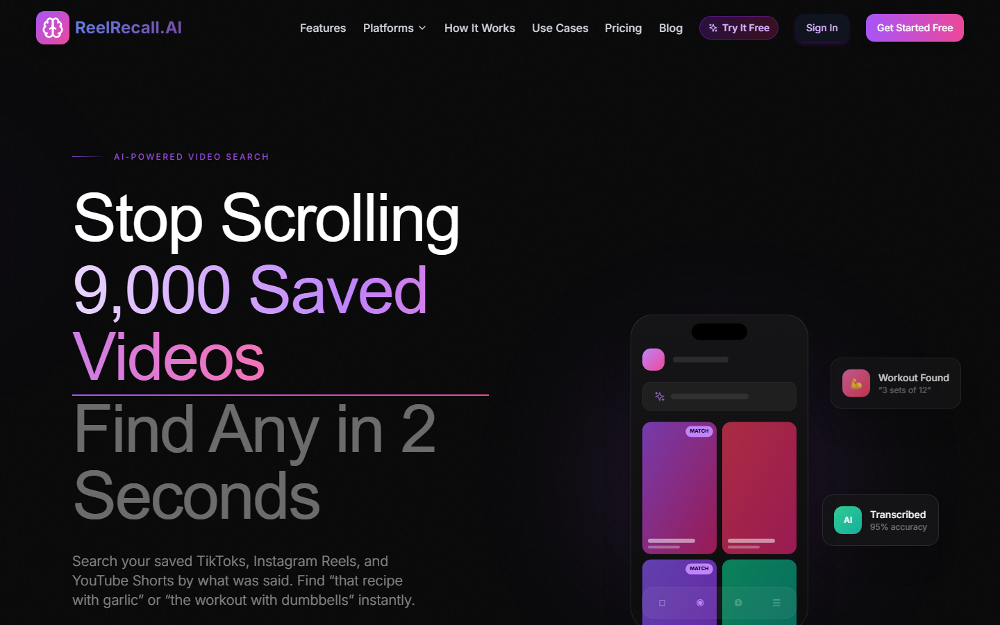
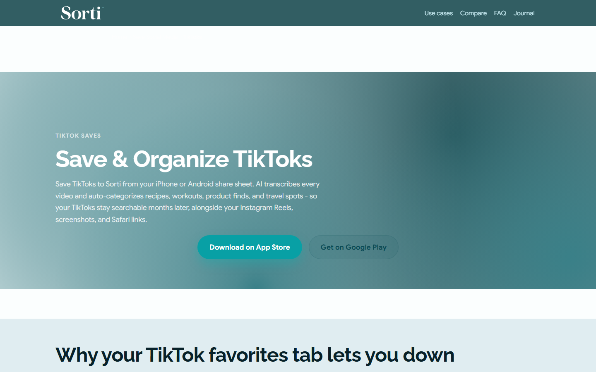
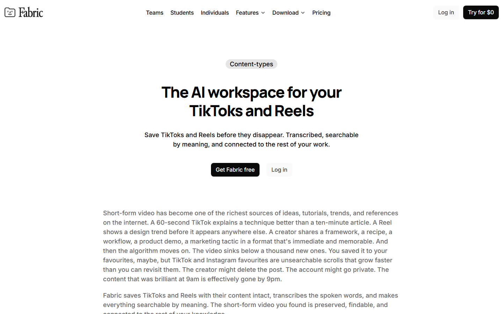
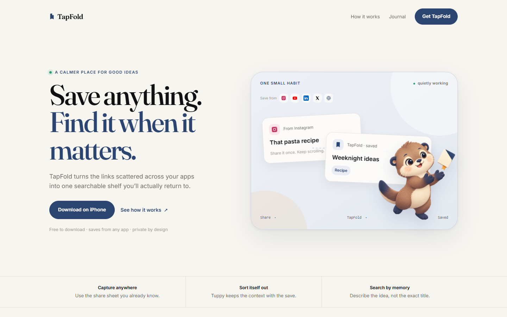
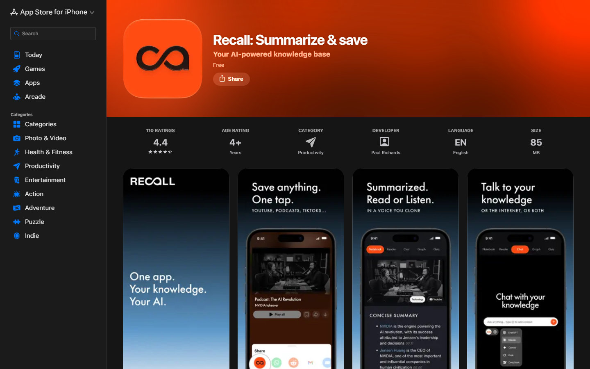
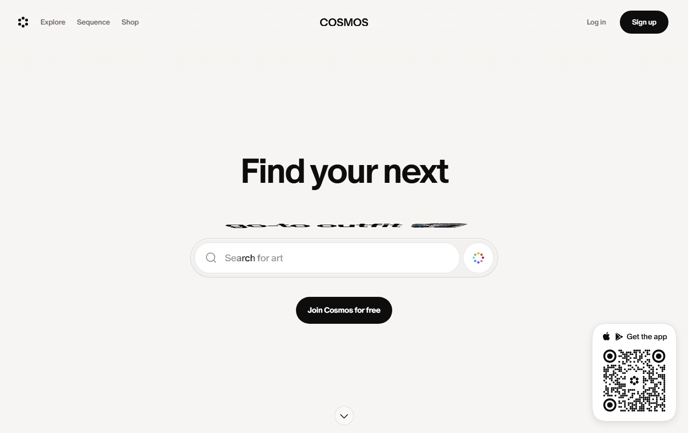

### Ручная проверка (MEM-88)

**Sorti — 10.10.2026, проверила Анастасия на телефоне.** Приложение сырое и с багами. Ролик из TikTok загружается, но **русскую речь не извлекает**: вместо содержания ролика оно выделило только «женщина говорит». Заявленный поиск по сказанному и анализ кадров для русскоязычных роликов фактически не работает. Вывод: как конкурент для русскоязычной аудитории Sorti слабый; это аргумент в пользу нашего отличия «русская речь».

### Чем мы отличаемся от мобильных конкурентов

| | ReelRecall, Sorti, Fabric, TapFold | MemSearch |
|---|---|---|
| Язык и контент | англоязычный рынок, русский не заявлен | русская речь, русскоязычный интерфейс |
| VK Клипы | нет | да |
| Перенос всего «Избранного» | нет: только «Поделиться» или ссылка по одной (у ReelRecall — расширение в платном тарифе) | расширение одной кнопкой, бесплатно |
| Поиск по кадру и тексту на экране | частично (Sorti распознаёт еду, товары, места) | текст в кадре и описание сцены |
| Доступ из России | магазины и оплата — под вопросом, зарубежные карты | работает из России, бесплатно |

Ограничения сравнения: функции взяты с сайтов самих приложений, вручную мы их не проверяли. Доступность в российских App Store и Google Play не проверялась.

### UX-решения, которые берём из мобильных аналогов

| Решение | Откуда | Как у нас |
|---|---|---|
| Закрепить приложение первым в меню «Поделиться» и подсказать, как это сделать | Sorti, Recall | экран онбординга с инструкцией для Android и iPhone |
| Автоколлекции по смыслу сохранения: рецепты, тренировки, покупки, места | Sorti | совпадает с целями сохранения из анкеты («повторить», «найти товар, место, песню») — темы BERTopic стоит именовать в этом стиле |
| Поиск момента внутри видео описанием сцены | Фото на iPhone, Google Фото | поиск по изображению (MEM-58, MEM-87), переход к таймкоду |
| Поиск по цвету и настроению картинки | Cosmos | идея на будущее для поиска по кадру |
| Сохранённая копия остаётся, даже если автор удалил ролик | Fabric | мы видео не храним — показываем честно «ролик удалён автором», но транскрипт и описание остаются |
| Привычка пересылать себе в Telegram | анкета, «Избранное» Telegram | Telegram-бот (MEM-85) |

## На что опираемся

**Продуктовая ниша.** Личная библиотека клипов VK, в которой ролик находится по смыслу сказанного, а коллекция сама раскладывается по темам. Бесплатно, на русском, без VPN.

**UX-решения, которые берём в user flow ([MEM-24](https://stackminds.atlassian.net/browse/MEM-24)):**

| Решение | Откуда | Как у нас |
|---|---|---|
| Карточка с пересказом и тегами сразу после сохранения | Recall | после обработки клипа — карточка: краткое описание, теги, тема, ссылка на VK |
| Поиск до произнесённого слова и переход к моменту | Raindrop, Яндекс | в выдаче — фрагмент речи, совпавший с запросом, и таймкод |
| Упорядочивание без ручной работы | mymind, Recall | автоматические темы и теги, **но с возможностью поправить** |
| Импорт всего «Избранного» одним действием | Dewey | в MVP — пакетное добавление списком ссылок; расширение браузера — после MVP |
| Подсказка тегов в момент сохранения | Raindrop | показываем предложенные теги сразу после обработки |

**Чего избегаем:**
- «Избранное» лентой без поиска (VK, TikTok);
- лимитов и платных ИИ-функций (Recall, Raindrop);
- непрозрачных автогрупп (mymind);
- отказа работать с короткими роликами (Яндекс, от 2 минут);
- зависимости от сервисов, недоступных из России или запрещающих российских пользователей (Twelve Labs, OpenAI, Anthropic).

**Технические решения** (модели, импорт, LLM, сервер) — в [../api/README.md](../api/README.md#решения-что-используем).

---

## Источники

Мобильные приложения: [ReelRecall](https://reelrecall.ai), [Sorti](https://letitsorti.com/save-tiktoks), [Fabric](https://fabric.so/for-your/tiktoks-and-reels), [TapFold](https://tapfold.com/blog/best-app-save-social-media/), [Recall в App Store](https://apps.apple.com/us/app/recall-summarize-save/id6445893722), [Cosmos](https://www.cosmos.so), [поиск в видео в Фото iOS 18.1](https://www.macrumors.com/how-to/ios-use-natural-language-search-photos/), [Ask Photos](https://blog.google/products-and-platforms/products/photos/ask-photos-google-io-2024/), [Saved Messages 2.0 в Telegram](https://telegram.org/blog/new-saved-messages-and-9-more).

1. Recall — [recall.it](https://www.recall.it), [docs.recall.it/developer/api](https://docs.recall.it/developer/api), [Chrome Web Store](https://chromewebstore.google.com/detail/recall-summarizer-youtube/ldbooahljamnocpaahaidnmlgfklbben)
2. Raindrop.io — [raindrop.io](https://raindrop.io), [обзор Pro](https://www.marqly.com/blog/raindrop-review-2026), [developer.raindrop.io](https://developer.raindrop.io)
3. mymind — [тарифы](https://access.mymind.com/pricing), [обзор](https://www.marqly.com/blog/mymind-review-2026)
4. Dewey — [getdewey.co/blog/tiktok-favorites-export](https://getdewey.co/blog/tiktok-favorites-export/)
5. Яндекс — [новость о пересказе видео](https://yandex.ru/company/news/01-06-10-2023), [Хабр](https://habr.com/ru/companies/yandex/articles/795397/)
6. Mediata — [mediata.ai/ru/video-notes](https://mediata.ai/ru/video-notes)
7. VK — [распознавание речи](https://www.ixbt.com/news/2025/12/08/vk-vk-vk.html), [мультимодальный поиск](https://vk.company/ru/press/releases/12230/), [Discovery AI](https://vc.ru/ai/3027970-vk-discovery-ai-poisk-neurosset)
8. Twelve Labs — [тарифы](https://www.twelvelabs.io/pricing), [условия использования](https://www.twelvelabs.io/legal/terms-of-use)
9. Memories.ai — [memories.ai](https://memories.ai), [документация](https://memories.ai/docs/)
