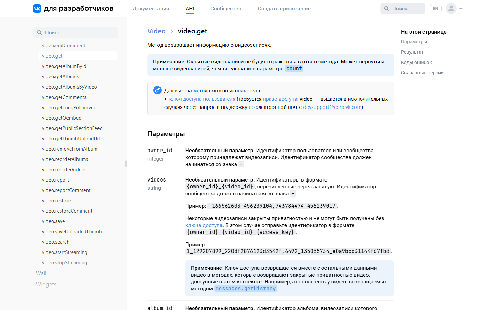
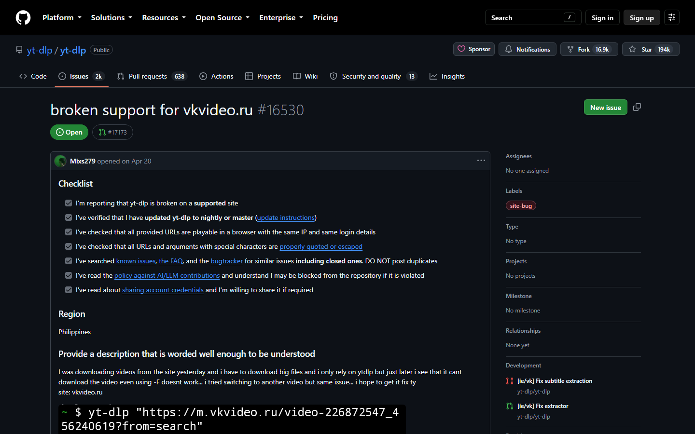
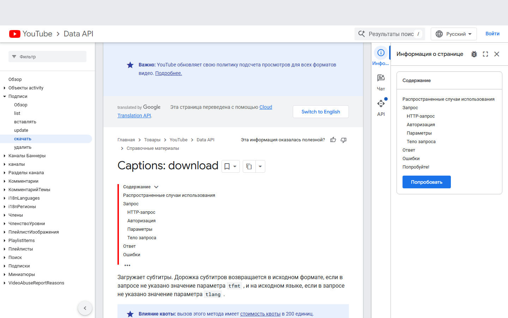
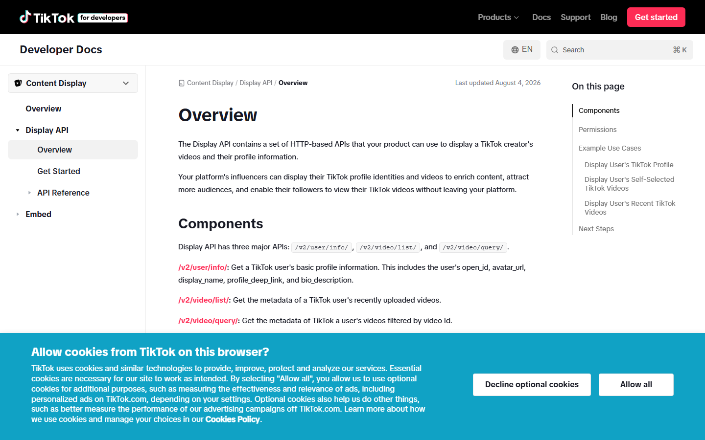
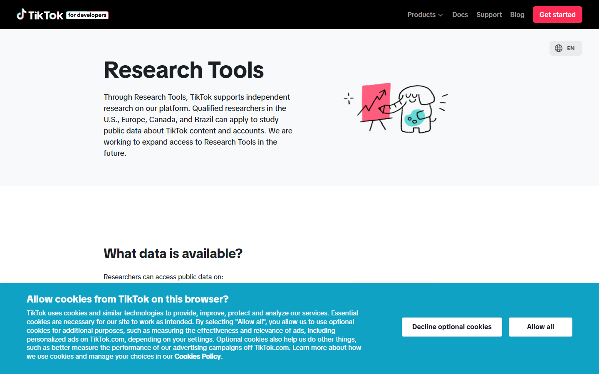
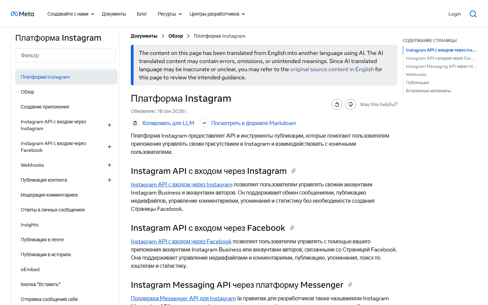
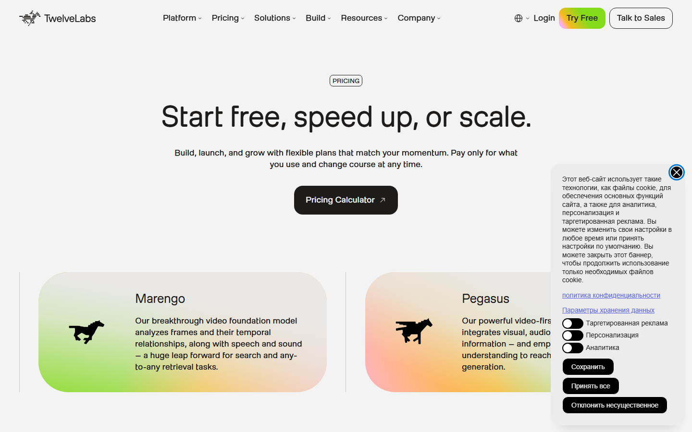
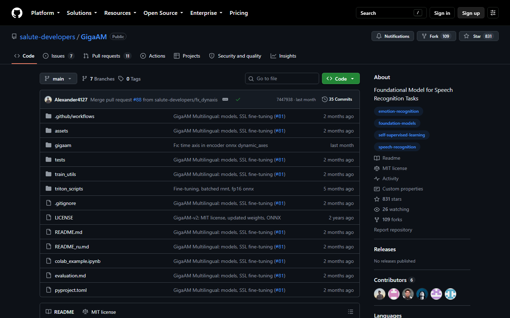

# API видеоплатформ и сервисов: что доступно и что используем

> Задачи [MEM-14](https://stackminds.atlassian.net/browse/MEM-14) (VK API) и [MEM-15](https://stackminds.atlassian.net/browse/MEM-15) (конкурентный анализ) · черновик от 30.09.2026.
> Обзор похожих продуктов — [../competitors/README.md](../competitors/README.md).

## Кратко

1. **Официально забрать «Избранное» пользователя не даёт ни одна платформа** — ни VK, ни YouTube, ни TikTok, ни Instagram. Поэтому в MVP клипы добавляются **по ссылке** и скачиваются через **yt-dlp**.
2. **Сервер и всё, что он вызывает, должны работать из России без VPN.** Отсюда выбор: открытые модели на своём сервере, а для текста — Kimi через российский агрегатор с оплатой в рублях. Twelve Labs, OpenAI и Anthropic не используем: они не обслуживают пользователей из России.
3. **VPN нужен только разработчикам** — для YouTube, Instagram и иногда для скачивания моделей. Пользователю сервиса VPN не нужен.

---

## Нужен ли VPN из России

Автоматическая проверка 30.09.2026 шла через нидерландский IP, поэтому таблица собрана по официальным источникам. Помеченное «проверить» подтверждаем руками без VPN.

| Сервис | Без VPN из России | Комментарий |
|---|---|---|
| VK, VK Видео, API VK | ✅ работает | — |
| Rutube, Дзен | ✅ работает | — |
| Kimi (Moonshot AI) | ⚠️ только через агрегатор | прямой API Moonshot из России недоступен, российские карты не принимаются; через российские агрегаторы с OpenAI-совместимым API (например, AITUNNEL) — работает, оплата в рублях |
| GigaChat API (Сбер) | ✅ работает | был выбран изначально, заменён на Kimi 10.10.2026; нужен сертификат НУЦ Минцифры |
| YandexGPT (Yandex AI Studio) | ✅ работает | нужен платёжный аккаунт Yandex Cloud |
| Яндекс 300, Mediata | ✅ работает | — |
| Hugging Face | ⚠️ в основном работает | открытые модели (e5, BGE-M3, Whisper, GigaAM) скачиваются; модели с ограниченным доступом (например, Llama) для России закрыты. Если не качается — зеркало через `HF_ENDPOINT` |
| TikTok | ⚠️ частично | формально не заблокирован, но для российских IP лента «заморожена» и публикация закрыта ([Т—Ж](https://t-j.ru/tiktok-come-back/)) |
| YouTube, YouTube Data API | ❌ нужен VPN | полностью заблокирован с 12.02.2026, до этого замедлялся с августа 2024 ([Википедия](https://en.wikipedia.org/wiki/Blocking_of_YouTube_in_Russia)) |
| Instagram, Graph API | ❌ нужен VPN | заблокирован с 2022 года; Meta признана в России экстремистской организацией |
| OpenAI API | ⛔ не использовать | Россия не входит в список поддерживаемых стран, API-трафик из неподдерживаемых стран блокируется ([OpenAI](https://platform.openai.com/docs/supported-countries)) |
| Anthropic (Claude) API | ⛔ не использовать | Россия не входит в поддерживаемые регионы ([Anthropic](https://anthropic.com/supported-countries)) |
| Twelve Labs | ⛔ не использовать | условия запрещают пользователей, находящихся в России ([Terms of Use](https://www.twelvelabs.io/legal/terms-of-use)) |
| Recall, Raindrop, mymind, Memories.ai | ❓ проверить | даже если сайт открывается, платные тарифы российскими картами не оплатить |

⛔ — VPN формально помогает, но это нарушение условий сервиса: аккаунт могут заблокировать. Для учебного проекта с демонстрацией заказчику это недопустимый риск.

Роскомнадзор блокирует и сами VPN: к марту 2026 г. заблокировано 469 VPN-сервисов, с декабря 2025 г. блокируются три самых популярных протокола ([Медиазона](https://en.zona.media/article/2026/04/07/russian_internet_censorship_2026)). Поэтому VPN не может быть частью архитектуры.

---

## 1. VK API

**Документация:** <https://dev.vk.com/ru/method/video>



**Что есть в разделе `video`** (проверено 30.09.2026): `video.get`, `video.getAlbums`, `video.getAlbumById`, `video.search`, `video.getComments`, `video.add`, `video.save`, `video.edit` и другие.

**`video.get`** возвращает ролики альбома пользователя (по умолчанию — «Добавленные») или ролики по списку идентификаторов:
- поля: название, описание, длительность, дата, превью в нескольких размерах, первый кадр, лайки, число комментариев;
- **требует право доступа `video`, которое «выдаётся в исключительных случаях через запрос в поддержку по электронной почте»**;
- скрытые ролики не возвращаются; закрытые приватностью — только с `access_key`.

**Чего нет:**
- методов раздела «Избранное» (`fave.*`) и отдельного раздела для клипов в текущей публичной документации нет: страницы `fave.get` и `shortVideo` отдают 404. Старые описания `fave.getVideos` встречаются только в сторонних справочниках 2016 года;
- метода получения субтитров или текста речи нет, хотя VK сама генерирует субтитры клипов.

**Примеры запросов.** Все методы вызываются через `https://api.vk.com/method/<метод>` с параметрами `access_token` и `v` (версия API).

Получить ролики альбома пользователя (нужен ключ с правом `video`):

```http
GET https://api.vk.com/method/video.get?owner_id=<id пользователя>&album_id=<id альбома>&count=50&offset=0&extended=0&access_token=<ключ>&v=5.199
```

Получить конкретные ролики по идентификаторам (закрытые — с `access_key`):

```http
GET https://api.vk.com/method/video.get?videos=-166562603_456239104,743784474_456239017&access_token=<ключ>&v=5.199
```

Ответ (сокращённый пример из документации VK):

```json
{
  "response": {
    "count": 1,
    "items": [{
      "date": 1671701032,
      "adding_date": 1671701038,
      "description": "",
      "duration": 15,
      "image": [{ "url": "https://i.mycdn.me/getVideoPreview?...&fn=vid_x", "width": 800, "height": 450 }],
      "first_frame": [{ "url": "https://i.mycdn.me/getVideoPreview?...&fn=vid_f", "width": 720, "height": 405 }],
      "can_add_to_faves": 1,
      "comments": 0
    }]
  }
}
```

Если у ключа нет права `video`, VK возвращает ошибку доступа: получить его может только приложение, которому поддержка VK выдала право.

Тот же клип через yt-dlp — без ключа VK:

```bash
# метаданные: название, описание, автор, дата, длительность, превью, список субтитров
yt-dlp --skip-download --dump-json "https://vk.com/clip-<owner>_<id>"
# только аудио для транскрибации и субтитры, если есть
yt-dlp -x --audio-format m4a --write-subs --sub-langs ru "https://vk.com/clip-<owner>_<id>"
```

**Ограничения VK API:**
- ключ пользователя с правом `video` выдаётся только через поддержку VK, в исключительных случаях;
- скрытые ролики не возвращаются, закрытые приватностью — только с `access_key`;
- `video.save` (загрузка) — не более 5 000 вызовов в сутки на приложение;
- методов для «Избранного», клипов и субтитров в публичной документации нет.

**Вывод:** импорт «Избранного» через API для MVP нереалистичен. Используем ссылки и yt-dlp. Можно попробовать запросить право `video` у поддержки VK — ответ не гарантирован, на MVP не закладываемся.

## 2. yt-dlp (скачивание по ссылке)

**Репозиторий:** <https://github.com/yt-dlp/yt-dlp> · экстрактор VK: [`yt_dlp/extractor/vk.py`](https://github.com/yt-dlp/yt-dlp/blob/master/yt_dlp/extractor/vk.py)

- экстрактор `VKIE` поддерживает ссылки `vk.com/video…`, **`vk.com/clip…`**, `vkvideo.ru`, `m.vk.com`, встроенные плееры;
- **забирает субтитры VK**, если они есть у ролика. Возможно, это бесплатный готовый транскрипт клипа — проверить в MEM-14 и сравнить с нашей транскрибацией в MEM-16;
- закрытые ролики скачиваются с cookies браузера: `--cookies-from-browser`;
- с Rutube, YouTube, TikTok тоже работает (для YouTube — с VPN).



⚠️ **Риск:** открыт баг [#16530](https://github.com/yt-dlp/yt-dlp/issues/16530) — перестало работать скачивание с vkvideo.ru, есть предложенное исправление. VK периодически ломает экстракторы.
**Меры:** зафиксировать рабочую версию yt-dlp в зависимостях, быстро обновлять при поломке, держать коллекцию для демо уже скачанной (MEM-20).

## 3. YouTube Data API v3

**Документация:** <https://developers.google.com/youtube/v3>



- плейлисты пользователя и их содержимое — да, с OAuth;
- «Смотреть позже» и история — **с 12.09.2016 возвращают пустой список**, даже для своего аккаунта ([revision history](https://developers.google.com/youtube/v3/revision_history));
- субтитры: `captions.download` работает только для роликов, которые пользователь может редактировать; чужие субтитры официально не получить;
- Shorts отдельным типом не выделяются;
- квота — 10 000 единиц в сутки, поиск стоит 100 единиц;
- **из России нужен VPN.**

**Вывод:** вне MVP. При расширении — импорт плейлиста по ссылке и своя транскрибация.

## 4. TikTok API

**Документация:** [Display API](https://developers.tiktok.com/doc/display-api-overview) · [Research API](https://developers.tiktok.com/products/research-api/)



- **Display API** (`video.list`) — только собственные публичные видео пользователя. Понравившиеся и «Избранное» не отдаются;
- **Research API** умеет получать понравившиеся видео пользователя, но доступен только академическим учреждениям США, ЕЭЗ, Великобритании, Канады и Швейцарии, некоммерческим организациям ЕС и бразильским организациям, изучающим безопасность детей. Нужно одобрение этической комиссии.



**Вывод:** для нас недоступно. Только ссылка на отдельный ролик.

## 5. Instagram API

**Документация:** <https://developers.facebook.com/docs/instagram-platform>



- доступ только к собственным медиа бизнес- или авторского аккаунта; у личных аккаунтов доступа к Reels через API нет;
- сохранённое не отдаётся;
- заблокирован в России, Meta признана экстремистской организацией.

**Вывод:** не рассматриваем.

## 6. Rutube

- публичной документации API нет: dev.rutube.ru недоступен, есть только [руководство по витринам](https://github.com/rutube/ShowcaseTutorial) и [API плеера](https://github.com/evikza/Rutube-Player-JS-API-Doc);
- для новых роликов с речью автосубтитры включены по умолчанию;
- без VPN.

**Вывод:** возможный второй источник после MVP, через yt-dlp.

## 7. API похожих сервисов

| Сервис | API | Что даёт | Для нас |
|---|---|---|---|
| Raindrop.io | [REST, OAuth2](https://developer.raindrop.io), 120 запросов/мин | закладки, коллекции, теги, импорт и экспорт | импорт закладок пользователя — идея на будущее |
| Recall | [REST, только чтение](https://docs.recall.it/developer/api) + MCP | карточки базы знаний, семантический поиск по ним | не нужен |
| mymind | нет | — | — |
| Twelve Labs | [REST и SDK](https://docs.twelvelabs.io) | индексация видео, мультимодальный поиск, генерация текста | ⛔ запрещено для России |
| Memories.ai | [REST](https://memories.ai/docs/) | индексация, семантический поиск по видео | не используем: ограничения для России не выяснены |



## 8. API и модели для нашего ML

| Задача | Вариант | Доступ из России | Цена |
|---|---|---|---|
| Распознавание речи | [GigaAM-v3](https://github.com/salute-developers/GigaAM) (Сбер, открытая) | ✅ скачивается с GitHub и Hugging Face | бесплатно, на своём сервере |
| Распознавание речи | faster-whisper (Whisper large-v3) | ✅ открытая модель | бесплатно |
| Распознавание речи | субтитры VK через yt-dlp | ✅ | бесплатно, если субтитры есть |
| Эмбеддинги | multilingual-e5 / BGE-M3 | ✅ открытые модели на Hugging Face | бесплатно |
| Краткие описания | [GigaChat API](https://developers.sber.ru/docs/ru/gigachat/tariffs/individual-tariffs), режим Freemium | ✅ | 1 000 000 токенов в год бесплатно, один поток |
| Краткие описания | YandexGPT Lite (Yandex AI Studio) | ✅ | ≈ 0,20 ₽ за 1000 токенов; нужен платёжный аккаунт |
| Краткие описания | открытая LLM на своём сервере (например, Qwen через Ollama) | ✅ | бесплатно, нужна видеокарта или терпение |
| Краткие описания | OpenAI, Anthropic | ⛔ | — |



**Про GigaAM и Whisper.** GigaAM-v3 обучена на 700 тыс. часов русской речи. На чистой речи у неё заметно меньше ошибок, чем у Whisper: 3,3 % WER против 7,9 % в одном из замеров. Но на шумных записях и речи вперемешку с английским Whisper бывает устойчивее ([Хабр](https://habr.com/ru/articles/1042574/)). В клипах много шума и музыки, поэтому модель выбираем замером на нашей коллекции (MEM-16), а не по бенчмаркам.

**Про объём (решение до 10.10, для GigaChat).** 100 клипов × около 1 500 токенов на запрос (транскрипт и ответ) ≈ 150 тыс. токенов. Бесплатной годовой квоты хватает на коллекцию и десятки переобработок.

---

## Решения: что используем

| Что | Решение | Почему | Запасной вариант |
|---|---|---|---|
| Источник видео в MVP | предзагруженная коллекция ~100 клипов VK, после демо — добавление по ссылке | API не отдаёт «Избранное» | запрос права `video` в поддержку VK |
| Скачивание | yt-dlp с зафиксированной версией, cookies для закрытых роликов | поддерживает `vk.com/clip`, забирает субтитры | обновление yt-dlp, заранее скачанная коллекция |
| Метаданные клипа | из yt-dlp: название, описание, автор, дата, длительность, превью | не нужно право `video` | `video.get`, если VK выдаст право |
| Текст речи | своя транскрибация: GigaAM-v3 или faster-whisper, выбираем в MEM-16 | модели открытые, работают без интернета | субтитры VK через yt-dlp, если они есть и качество приемлемое |
| Эмбеддинги и поиск | multilingual-e5 или BGE-M3 (выбор в MEM-76) + pgvector; полнотекстовый поиск PostgreSQL как базовая линия (MEM-80) | открытые модели, данные не уходят третьим лицам | — |
| Краткие описания и названия тем | **Kimi (Moonshot AI)** через OpenAI-совместимый API российского агрегатора, оплата в рублях | сильная модель, дёшево (~0,1–0,2 ₽ за описание), работает с сервера в России без VPN | DeepSeek или Qwen через тот же агрегатор — смена модели настройкой |
| Темы и теги | BERTopic поверх наших эмбеддингов | работает локально | — |
| Сервер | российский хостинг или сервер вуза | должен работать без VPN | — |
| Эксперименты | Colab или свои машины; модели с Hugging Face | — | зеркало Hugging Face через `HF_ENDPOINT` |
| Не используем | Twelve Labs, OpenAI, Anthropic, Memories.ai, API YouTube, TikTok, Instagram | недоступны из России или запрещают российских пользователей | — |

**Что проверить до конца спринта 3:**
- [ ] yt-dlp скачивает клип VK по ссылке `vk.com/clip…` и забирает субтитры (MEM-14)
- [ ] качество субтитров VK против GigaAM и Whisper на 10 клипах (MEM-16)
- [ ] завести аккаунт агрегатора с Kimi, пополнить баланс (от ~500 ₽), прогнать один пересказ на клипе из коллекции
- [ ] модели скачиваются с Hugging Face без VPN

## Источники

1. VK для разработчиков — [video](https://dev.vk.com/ru/method/video), [video.get](https://dev.vk.com/ru/method/video.get)
2. yt-dlp — [экстрактор VK](https://github.com/yt-dlp/yt-dlp/blob/master/yt_dlp/extractor/vk.py), [issue #16530](https://github.com/yt-dlp/yt-dlp/issues/16530)
3. YouTube Data API — [revision history](https://developers.google.com/youtube/v3/revision_history), [captions.download](https://developers.google.com/youtube/v3/docs/captions/download)
4. TikTok — [Display API](https://developers.tiktok.com/doc/display-api-overview), [Research API](https://developers.tiktok.com/products/research-api/)
5. Instagram — [Instagram Platform](https://developers.facebook.com/docs/instagram-platform), [обзор Reels API](https://www.getphyllo.com/post/a-complete-guide-to-the-instagram-reels-api)
6. Rutube — [ShowcaseTutorial](https://github.com/rutube/ShowcaseTutorial), [автосубтитры](https://mobile-review.com/all/news/rutube-vvyol-avtogeneracziyu-subtitrov-dlya-polzovatelskogo-kontenta/)
7. Raindrop.io API — [developer.raindrop.io](https://developer.raindrop.io); Recall API — [docs.recall.it](https://docs.recall.it/developer/api)
8. Twelve Labs — [тарифы](https://www.twelvelabs.io/pricing), [условия использования](https://www.twelvelabs.io/legal/terms-of-use)
9. GigaChat API — [тарифы для физлиц](https://developers.sber.ru/docs/ru/gigachat/tariffs/individual-tariffs), [быстрый старт](https://developers.sber.ru/docs/ru/gigachat/individuals-quickstart)
10. YandexGPT — [цены API](https://vc.ru/provod/3035416-yandexgpt-api-pervyj-zapros-i-raschet-stoimosti)
11. GigaAM — [GitHub](https://github.com/salute-developers/GigaAM), [сравнение с Whisper](https://habr.com/ru/articles/1042574/)
12. Блокировки — [YouTube](https://en.wikipedia.org/wiki/Blocking_of_YouTube_in_Russia), [TikTok](https://t-j.ru/tiktok-come-back/), [VPN в 2026](https://en.zona.media/article/2026/04/07/russian_internet_censorship_2026), [OpenAI](https://platform.openai.com/docs/supported-countries), [Anthropic](https://anthropic.com/supported-countries), [Hugging Face](https://discuss.huggingface.co/t/access-denied-trying-to-download-any-model/177783)
